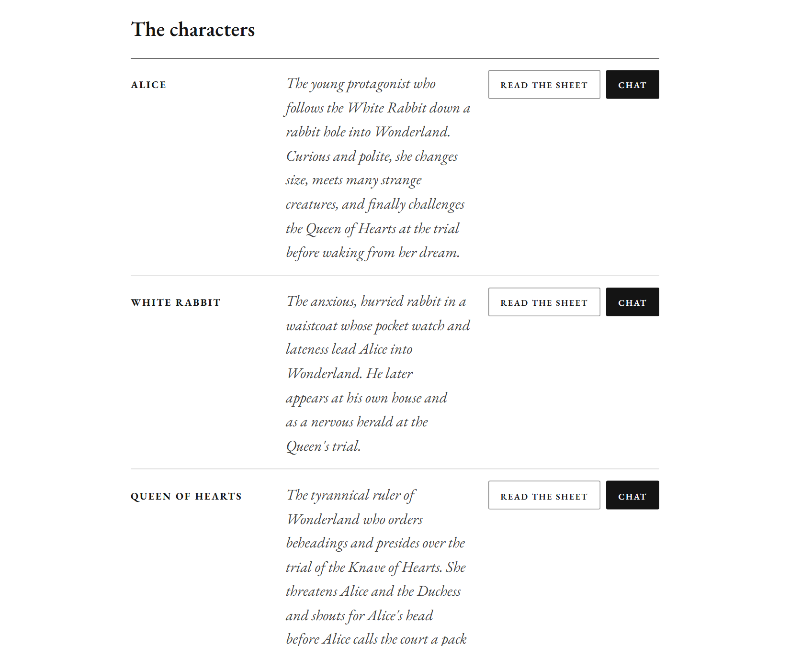

# LivingPaper

> Chat with the characters of your books.

https://github.com/user-attachments/assets/a6644874-cca2-4a42-8805-078fd20c5fb9

[](https://github.com/AntoineYREM/LivingPaper/releases)
[](https://github.com/AntoineYREM/LivingPaper/actions/workflows/ci.yml)
[](LICENSE)

LivingPaper is an open-source web app. You add a book (EPUB or PDF), an AI reads it and extracts the main characters with a
personality profile, then you chat with a character as if texting them. It is **self-hosted** and for one person: you bring your
own API key for any OpenAI-compatible provider (OpenAI, another vendor, or a model running on your computer).

## Try the examples

The **Examples** page holds public-domain books that are already analyzed. You can read their summaries, the story scene by scene
and the sheets of their characters **without any API key**; only the chat needs a language model.

## Screenshots

The shipped examples, in the interface. Black ink on white paper, like a printed novel.

| The examples | The characters of a book | Chat with a character |
|---|---|---|
|  |  |  |

On a phone, the same pages fit the screen:


## What it does

- **Add a book** (EPUB or PDF): it is analyzed in the background, with progress, a retry that does not pay twice, and the tokens
  used shown at the end.
- **Get the 10 main characters**, each with a short description and a personality profile that you can edit, and the **story of
  the book scene by scene**, which every character knows when it chats.
- **Chat with a character**: first person, short text-message replies, streamed, in the language you write in. Nothing is stored.
- **Read the examples without a key**: the **Examples** page has public-domain books that are already analyzed; a model is only
  needed to chat.
- **Export and import** a book as a JSON file, to move it or share it.
- **Read and edit every prompt** in `data/prompts.json`.
- **English** interface. French is translated and kept in reserve: add it to the `LANGUAGES` setting to bring it back.
- **Your data stays with you**: plain JSON files in a folder, API keys encrypted at rest, book text deleted after the analysis.

## Quick start (Docker)

You need Docker with Compose.

```bash
git clone https://github.com/AntoineYREM/LivingPaper.git
cd LivingPaper
docker compose up --build
```

Or, without building, with the published image (see [docs/how-to-run.md](docs/how-to-run.md#without-building-the-published-image)):
`ghcr.io/antoineyrem/livingpaper:latest`.

Then open <http://localhost:8080>:

1. Open **Settings** and add a language model: type a name, the base URL and the API key, press **Get the models**, choose a model in
   the list and save. The list the provider returns proves that the key works.
   Choose it for the analysis and for the chat.
2. On the home page, **Add a book**. The analysis starts by itself; the list shows where it is.
3. Open the book, pick a character and press **Chat**.

Your data is kept in the Docker volume `livingpaper-data` and survives `docker compose down` (not `down -v`). To use the
published image instead of building it, run from source, change a setting or reach a model on your computer (Ollama, LM Studio), see [docs/how-to-run.md](docs/how-to-run.md).

### Use a model running on your computer

With Ollama, add a model in **Settings** with the base URL `http://host.docker.internal:11434/v1` (from Docker; `localhost` would
be the container itself), any text as the key, and the name of a model you pulled. Private addresses are allowed on purpose so that
local models work. Details and LM Studio: [docs/how-to-run.md](docs/how-to-run.md#add-a-language-model).

## Warnings

- **LivingPaper has no authentication.** Anyone who can reach it can use the API keys you saved. It is made for personal use on
  your own computer or network. **Do not expose it to the Internet** without a reverse proxy that requires a sign-in. Docker
  publishes the port on `127.0.0.1` only, on purpose. See [SECURITY.md](SECURITY.md).
- **Spoilers.** Character sheets and the chat cover the **whole book**: a character may reveal the ending.
- **Costs.** Analyzing a book calls your provider many times (one play, with a small model, used about 110,000 input and 75,000 output
  tokens). The tokens used are shown at the end of each analysis. A local model costs nothing.
- **Copyright.** Add books you have the right to read and analyze. The examples are public-domain works only. The text of a book
  is sent to the provider you chose, and nowhere else.

## Documentation

| | |
|---|---|
| [docs/how-to-run.md](docs/how-to-run.md) | Docker, from source, configuration, local models, backup, troubleshooting |
| [docs/reference.md](docs/reference.md) | Each part in detail: prompts, models and keys, books, analysis, chat, examples, export and import |
| [docs/how-to-test.md](docs/how-to-test.md) | Run and write tests, reproduce the CI |
| [docs/architecture.md](docs/architecture.md) | The layers, the ports, the main flows |
| [docs/decisions](docs/decisions/README.md) | Why the project is the way it is (ADRs) |
| [ROADMAP.md](ROADMAP.md) | What exists, what may come |
| [CONTRIBUTING.md](CONTRIBUTING.md) | How to contribute (fork and pull request, CLA, AI-assisted contributions) |
| [CHANGELOG.md](CHANGELOG.md) | What changed in each version |
| [THIRD-PARTY-NOTICES.md](THIRD-PARTY-NOTICES.md) | Dependencies and their licenses |

## Contributing

Contributions are welcome: read [CONTRIBUTING.md](CONTRIBUTING.md). Every external contribution needs a signed
[CLA](CLA.md) (you keep the ownership of your work). Everyone is expected to follow the [Code of Conduct](CODE_OF_CONDUCT.md).
Report a security problem as said in [SECURITY.md](SECURITY.md).

## License

LivingPaper is free software under the **GNU Affero General Public License v3.0** ([LICENSE](LICENSE)): you can use, study, share
and modify it, and if you run a modified version for other people over a network you must publish your changes. Copyright (C) 2026
AntoineYREM. The analyses of the `examples/` folder are under CC0 ([examples/LICENSE](examples/LICENSE)). The licenses of the
dependencies, all compatible with the AGPL, are in [THIRD-PARTY-NOTICES.md](THIRD-PARTY-NOTICES.md).

