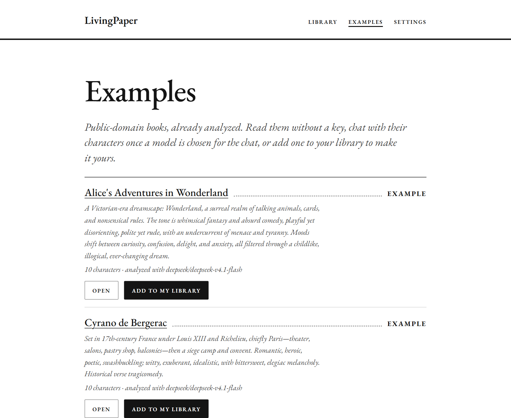
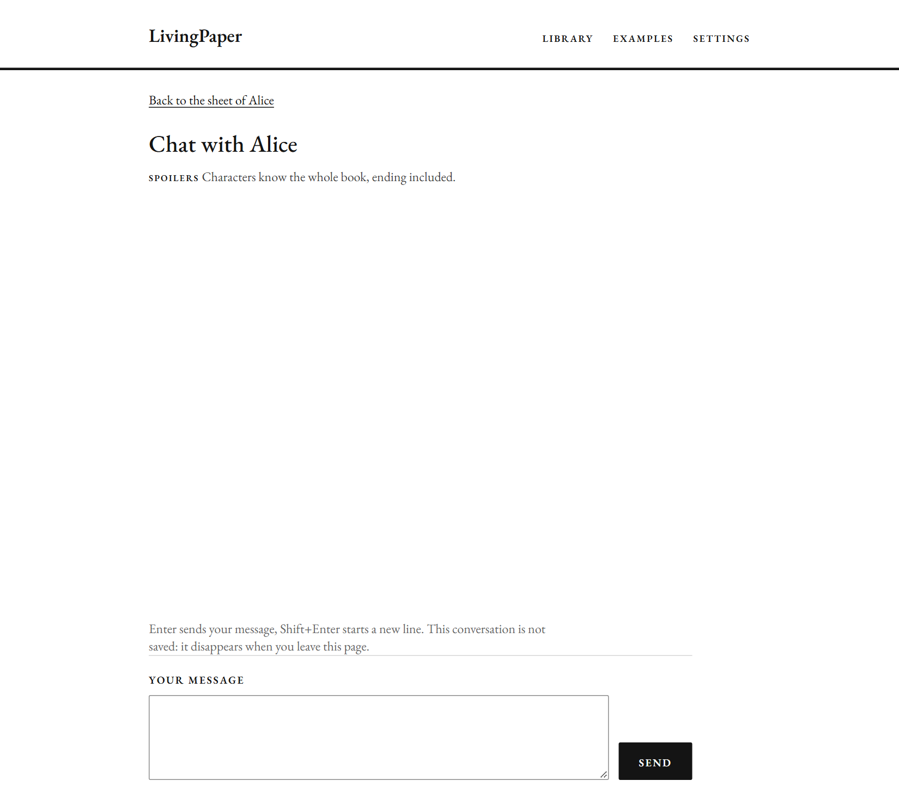
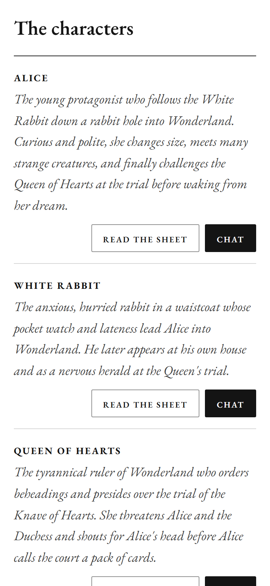

# LivingPaper

> Chat with the characters of your books.

https://github.com/user-attachments/assets/a6644874-cca2-4a42-8805-078fd20c5fb9

[](https://github.com/AntoineYREM/LivingPaper/releases)
[](https://github.com/AntoineYREM/LivingPaper/actions/workflows/ci.yml)
[](LICENSE)

LivingPaper is an open-source web app. You add a book (EPUB or PDF), an AI reads it and extracts the main characters with a
personality profile, then you chat with a character as if texting them. It is **self-hosted** and for one person: you bring your
own API key for any OpenAI-compatible provider (OpenAI, another vendor, or a model running on your computer).

## Try the examples

The **Examples** page holds three public-domain books that are already analyzed, in English: *Alice's Adventures in Wonderland*,
*Cyrano de Bergerac* and *Madame Bovary*. You can read their summaries, the story scene by scene and the sheets of their
characters **without any API key**; only the chat needs a language model. They come with the [passages of the
book](#the-passages-of-the-book-optional) and their vectors, made with `bge-m3`.

## Screenshots

The shipped examples, in the interface. Black ink on white paper, like a printed novel.

| The examples | The characters of a book | Chat with a character |
|---|---|---|
|  |  |  |

On a phone, the same pages fit the screen:



## What it does

- **Add a book** (EPUB or PDF): it is analyzed in the background, with progress, a retry that does not pay twice, and the tokens
  used shown at the end.
- **Get the 10 main characters**, each with a short description and a personality profile that you can edit, and the **story of
  the book scene by scene**, which every character knows when it chats.
- **Chat with a character**: first person, short text-message replies, streamed, in the language you write in. Nothing is stored.
- **Read the examples without a key**: the **Examples** page has public-domain books that are already analyzed; a model is only
  needed to chat.
- **Export and import** a book as a JSON file, to move it or share it. With passages kept (see below), the file holds the text of
  the book.
- **Read and edit every prompt** in `data/prompts.json`.
- **English** interface. French is translated and kept in reserve: add it to the `LANGUAGES` setting to bring it back.
- **Your data stays with you**: plain JSON files in a folder, API keys encrypted at rest, book text deleted after the analysis
  (its passages are kept only if you choose a model for vectorization).

## How well do the characters answer?

Measured on 27 November 2026 on four books, one of them little known, with 212 new questions fixed before the runs, two models
and a language model as the judge ([full report](docs/experiments/before-and-after.md)). **Start**: the character is given the
story of the book. **Now**: passages of the book found by two searches, and a character that is told to say when it does not
remember (the code of `main`, after version 0.5.0; it needs a [model for vectorization](#the-passages-of-the-book-optional)).

| | DeepSeek V4.1 Flash, start | **now** | Mistral Small 3.2, start | **now** |
|---|---|---|---|---|
| Right answers, 140 factual questions | 61 % | **78 %** | 45 % | **77 %** |
| False statements, same questions | 21 % | **5 %** | 41 % | **14 %** |
| Traps the book cannot answer, nothing made up in answer (of 20) | 13 | **19** | 5 | **17** |
| Staying in role, 40 questions, grade out of 5 | 4.85 | **4.95** | 4.35 | **4.40** |
| Median time of a reply | 2.7 s | **1.4 s** | 1.7 s | **1.6 s** |

<picture>
  <source media="(prefers-color-scheme: dark)" srcset="docs/images/evals/before-after-dark.svg">
  
</picture>

What each change brought:

- **Passages of the book:** most of the gain, +21 and +30 points of right answers.
- **Saying "I do not remember":** DeepSeek's false statements fell from 11 % to 1 %, at the price of 9 points of right answers;
  little effect on Mistral.
- **Two searches** (the recent messages and the last one): far better after a change of subject (42 to 85 % and 45 to 72 % right),
  **worse on follow-ups** such as "And where did he go?" (88 to 72 % and 90 to 75 %). Overall, no difference beyond chance.

Read these figures with care. An AI assistant wrote most questions while reading the passages, which favors the search: on 12
questions about famous episodes of *Madame Bovary*, chosen by a reader, there was **no gain** (12 to 8 right with DeepSeek, 9 to
8 with Mistral). Each question was asked once. The judge agreed with a person, within one point, on 29 replies of 30.

### Staying in role: what the judge first helped improve

On 23 November 2026, a language model used as a judge graded 40 questions to Emma Bovary (everyday ones, and traps: a
smartphone, "are you an AI?", a request for a recipe). Its reasons showed what to correct, and five rules were added to the chat
prompt. The average grade, out of 5, before and after:

<picture>
  <source media="(prefers-color-scheme: dark)" srcset="docs/images/evals/quality-dark.svg">
  
</picture>

These runs used the prompt and the character sheets of that time: do not compare their grades with those of the table above.
The figures of nine models, their price and their speed: [evals/README.md](evals/README.md).

## Quick start (Docker)

You need Docker with Compose.

```bash
git clone https://github.com/AntoineYREM/LivingPaper.git
cd LivingPaper
docker compose up --build
```

Or, without building, with the published image (see [docs/how-to-run.md](docs/how-to-run.md#without-building-the-published-image)):
`ghcr.io/antoineyrem/livingpaper:latest`.

Then open <http://localhost:8080>:

1. Open **Settings** and add a language model: type a name, the base URL and the API key, press **Get the models**, choose a model in
   the list and save. The list the provider returns proves that the key works.
   Choose it for the analysis and for the chat.
2. On the home page, **Add a book**. The analysis starts by itself; the list shows where it is.
3. Open the book, pick a character and press **Chat**.

Your data is kept in the Docker volume `livingpaper-data` and survives `docker compose down` (not `down -v`). To use the
published image instead of building it, run from source, change a setting or reach a model on your computer (Ollama, LM Studio), see [docs/how-to-run.md](docs/how-to-run.md).

### Use a model running on your computer

With Ollama, add a model in **Settings** with the base URL `http://host.docker.internal:11434/v1` (from Docker; `localhost` would
be the container itself), any text as the key, and the name of a model you pulled. Private addresses are allowed on purpose so that
local models work. Details and LM Studio: [docs/how-to-run.md](docs/how-to-run.md#add-a-language-model).

### The passages of the book (optional)

By default a character knows the book through its story, scene by scene. With a **model for vectorization** (an embedding model),
LivingPaper also keeps the book cut into passages, and gives the character four passages that answer your message, searched with
your last message and with the ones before it: it can then give details that a summary loses
([how much it changes](#how-well-do-the-characters-answer)).

1. Choose a **multilingual** model, so that you can write in your language about a book in another. We use and recommend
   **`bge-m3`** (free on your computer: `ollama pull bge-m3`).
2. In **Settings**, add it and choose it as **Model for vectorization**.
3. Analyze a book, or open an example and press **Index the passages**: with `bge-m3`, an example uses the vectors it comes
   with and computes nothing but one test.

With passages, the chat model needs a context of **at least 8,192 tokens**. Some local servers start with less: Ollama uses
4,096 on a 4 GB graphics card, set `OLLAMA_CONTEXT_LENGTH=8192`.

## Warnings

- **LivingPaper has no authentication.** Anyone who can reach it can use the API keys you saved. It is made for personal use on
  your own computer or network. **Do not expose it to the Internet** without a reverse proxy that requires a sign-in. Docker
  publishes the port on `127.0.0.1` only, on purpose. See [SECURITY.md](SECURITY.md).
- **Spoilers.** Character sheets and the chat cover the **whole book**: a character may reveal the ending.
- **Costs.** Analyzing a book calls your provider many times (one play, with a small model, used about 110,000 input and 75,000 output
  tokens). The tokens used are shown at the end of each analysis. A local model costs nothing.
- **Copyright.** Add books you have the right to read and analyze. The examples are public-domain works only. The text of a book
  is sent to the providers you chose, and the application sends it nowhere else. With a model for vectorization, **an exported
  book holds its text**: share the file only if you have the right to.

## Documentation

| | |
|---|---|
| [docs/how-to-run.md](docs/how-to-run.md) | Docker, from source, configuration, local models, backup, troubleshooting |
| [docs/reference.md](docs/reference.md) | Each part in detail: prompts, models and keys, books, analysis, chat, examples, export and import |
| [docs/how-to-test.md](docs/how-to-test.md) | Run and write tests, reproduce the CI |
| [docs/architecture.md](docs/architecture.md) | The layers, the ports, the main flows |
| [docs/decisions](docs/decisions/README.md) | Why the project is the way it is (ADRs) |
| [ROADMAP.md](ROADMAP.md) | What exists, what may come |
| [CONTRIBUTING.md](CONTRIBUTING.md) | How to contribute (fork and pull request, CLA, AI-assisted contributions) |
| [CHANGELOG.md](CHANGELOG.md) | What changed in each version |
| [THIRD-PARTY-NOTICES.md](THIRD-PARTY-NOTICES.md) | Dependencies and their licenses |

## Contributing

Contributions are welcome: read [CONTRIBUTING.md](CONTRIBUTING.md). Every external contribution needs a signed
[CLA](CLA.md) (you keep the ownership of your work). Everyone is expected to follow the [Code of Conduct](CODE_OF_CONDUCT.md).
Report a security problem as said in [SECURITY.md](SECURITY.md).

## License

LivingPaper is free software under the **GNU Affero General Public License v3.0** ([LICENSE](LICENSE)): you can use, study, share
and modify it, and if you run a modified version for other people over a network you must publish your changes. Copyright (C) 2026
AntoineYREM. The analyses of the `examples/` folder are under CC0 ([examples/LICENSE](examples/LICENSE)). The licenses of the
dependencies, all compatible with the AGPL, are in [THIRD-PARTY-NOTICES.md](THIRD-PARTY-NOTICES.md).

