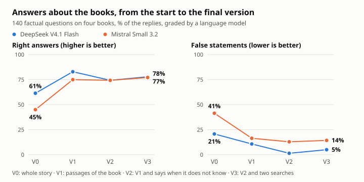

# Experiments: before and after the passages of the book

What the work from the whole story to the present chat changed (PAPER-95), measured on 27 November 2026.

**Read the figures with care:** see [limits](#limits). The runs are in
[`evals/published/before-after/`](../../evals/published/before-after/), and `python3 evals/before-after/report.py` prints every
table below from them (`--chart` redraws the picture).

## Conclusions

1. **From the start to now, the characters are right more often and make up less**, with both models and beyond chance: right
   answers 61 to 78 % and 45 to 77 %, false statements 21 to 5 % and 41 to 14 %.
2. **The passages of the book bring most of it** (right answers +21 and +30 points).
3. **Saying "I do not remember"** cut DeepSeek's false statements to 1 %, and cost it 9 points of right answers; little effect on
   Mistral.
4. **Two searches are not a gain overall.** They repair a change of subject and **hurt follow-ups**, most on the longest book. The
   difference with one search is within chance.
5. **No gain on the 12 questions chosen by a reader** about famous episodes.
6. **The role is kept**; prompts are about as long as at the start, and replies came as fast or faster.

## What was compared

Each version adds one change to the one before.

| Version | What the character gets | Code and prompts |
|---|---|---|
| V0, start | The whole story; the earlier chat prompt | `main`, `evals/prompts/published.json` |
| V1, passages | 3 passages, one search with the recent messages | commit `889aee2` (0.5.0), `published.json` |
| V2, honesty | V1, and "say that you do not remember" (PAPER-92) | commit `3f975c0`, its default prompts |
| V3, two searches | 4 passages: 1 with the recent messages, 3 with the last one (PAPER-94) | `main`, default prompts |

V0 is not the old program: it is the present code with no passages, the earlier prompt and the present analyses of the books.

- **Books:** *Alice's Adventures in Wonderland*, *Cyrano de Bergerac*, *Madame Bovary* and the little-known *Miss Cayley's
  Adventures* (Grant Allen, 1899), analyzed for this measure with DeepSeek V4.1 Flash. Passages vectorized with `bge-m3`.
- **Characters:** DeepSeek V4.1 Flash and Mistral Small 3.2 (24B), through OpenRouter.
- **Judge:** Claude Haiku 5.5, with `evals/accuracy-judge.json` (facts), `evals/trap-judge.json` (traps) and `evals/judge.json`
  (role).
- **Questions** (`evals/before-after/`), 212 for each version and model, committed before the first run (commit `ba43fe2`), on
  passages that no earlier question used: for each book 10 direct, 10 on a new subject after another one, 10 short follow-ups,
  5 more precise follow-ups after an admission (the 140 factual questions), and 5 traps whose answer the book does not give; 12
  about *Madame Bovary* on subjects a reader found in a public quiz, put in our own words; and the 40 role questions to Emma.
- One try a question. 1,696 replies, and 70 without the book. Cost: under 1 USD.

A **right** answer is graded 4 or 5, a **false** statement 1. Grade 2 does not give the fact ("I do not remember" among them).

## Facts

| Right / false, % | V0 | V1 | V2 | V3 |
|---|---|---|---|---|
| DeepSeek V4.1 Flash | 61 / 21 | 83 / 11 | 74 / 1 | 78 / 5 |
| Mistral Small 3.2 | 45 / 41 | 75 / 16 | 74 / 13 | 77 / 14 |

| Replies, of 140: right / partly / without the fact / false | V0 | V1 | V2 | V3 |
|---|---|---|---|---|
| DeepSeek | 86 / 19 / 6 / 29 | 116 / 7 / 2 / 15 | 104 / 3 / 31 / 2 | 109 / 8 / 16 / 7 |
| Mistral | 63 / 10 / 9 / 58 | 105 / 6 / 6 / 23 | 104 / 4 / 14 / 18 | 108 / 8 / 4 / 20 |

Change in points, question by question, with the 95 % interval (an interval that includes 0 can be chance):

| | DeepSeek, right | DeepSeek, false | Mistral, right | Mistral, false |
|---|---|---|---|---|
| V0 to V1 | +21 (+13 to +30) | -10 (-17 to -3) | +30 (+21 to +39) | -25 (-34 to -16) |
| V1 to V2 | -9 (-15 to -2) | -9 (-14 to -4) | -1 (-6 to +4) | -4 (-8 to +1) |
| V2 to V3 | +4 (-5 to +13) | +4 (-1 to +8) | +3 (-5 to +11) | +1 (-6 to +9) |
| **V0 to V3** | **+16 (+7 to +26)** | **-16 (-23 to -8)** | **+32 (+22 to +42)** | **-27 (-37 to -18)** |

### By kind of question

| Right / false, % | V0 | V1 | V2 | V3 |
|---|---|---|---|---|
| DeepSeek, direct | 58 / 22 | 88 / 10 | 82 / 2 | 78 / 2 |
| DeepSeek, new subject | 60 / 20 | 68 / 22 | 42 / 2 | 85 / 5 |
| DeepSeek, short follow-up | 58 / 22 | 90 / 5 | 88 / 0 | 72 / 8 |
| DeepSeek, precise follow-up | 80 / 15 | 90 / 0 | 95 / 0 | 75 / 5 |
| Mistral, direct | 58 / 30 | 80 / 15 | 80 / 15 | 82 / 10 |
| Mistral, new subject | 35 / 50 | 55 / 35 | 45 / 25 | 72 / 12 |
| Mistral, short follow-up | 42 / 42 | 85 / 5 | 90 / 2 | 75 / 18 |
| Mistral, precise follow-up | 45 / 45 | 85 / 5 | 90 / 5 | 80 / 20 |

### By book

| Right / false, % | V0 | V1 | V2 | V3 |
|---|---|---|---|---|
| DeepSeek, *Alice* | 91 / 0 | 94 / 0 | 77 / 0 | 94 / 0 |
| DeepSeek, *Cyrano* | 60 / 23 | 80 / 17 | 74 / 6 | 74 / 3 |
| DeepSeek, *Madame Bovary* | 54 / 26 | 80 / 9 | 69 / 0 | 57 / 9 |
| DeepSeek, *Miss Cayley* | 40 / 34 | 77 / 17 | 77 / 0 | 86 / 9 |
| Mistral, *Alice* | 46 / 37 | 80 / 11 | 71 / 11 | 83 / 9 |
| Mistral, *Cyrano* | 43 / 43 | 69 / 23 | 77 / 17 | 83 / 14 |
| Mistral, *Madame Bovary* | 37 / 49 | 74 / 20 | 71 / 17 | 54 / 26 |
| Mistral, *Miss Cayley* | 54 / 37 | 77 / 11 | 77 / 6 | 89 / 9 |

**Without the book** (no story, no passage, the earlier prompt, the sheet of the character only), on the 35 factual questions of
*Miss Cayley*: DeepSeek 43 % right and 54 % false, Mistral 23 % and 63 %. The book is less known than the others, not unknown.

## The search

| Expected passage found, % | V1 and V2 | V3 |
|---|---|---|
| All factual questions | 69 | 77 |
| Direct | 82 | 82 |
| New subject | 30 | 80 |
| Short follow-up | 85 | 68 |
| Precise follow-up | 85 | 80 |

With a single passage for the recent messages, a follow-up loses what it was about: on *Madame Bovary*, over its short and
precise follow-ups, V3 found far less often the passage that V2 found. The earlier measure of PAPER-94 had seen it on 7 short
follow-ups ([experiments](admitting-not-knowing.md)).

## Traps, reader's questions, role

| Of 20 traps: no answer made up (grades 4 and 5), among them nothing else added (5) | V0 | V1 | V2 | V3 |
|---|---|---|---|---|
| DeepSeek | 13 (4) | 16 (3) | 20 (14) | 19 (11) |
| Mistral | 5 (3) | 7 (2) | 16 (5) | 17 (8) |

Grade 4 does not answer the question, but adds a detail about something else that the book does not say.

| The 12 questions of a reader: right (false) | V0 | V1 | V2 | V3 |
|---|---|---|---|---|
| DeepSeek | 12 (0) | 9 (1) | 10 (1) | 8 (0) |
| Mistral | 9 (1) | 8 (1) | 7 (1) | 8 (0) |

These are famous episodes, which the story tells and the models know; some were also asked while the defaults were tuned.

| Role, average of 40 questions (replies graded 2 or less) | V0 | V1 | V2 | V3 |
|---|---|---|---|---|
| DeepSeek | 4.85 (0) | 4.90 (0) | 4.92 (0) | 4.95 (0) |
| Mistral | 4.35 (4) | 4.58 (4) | 4.50 (4) | 4.40 (3) |

## Cost and time

| Per reply, the role questions left out | V0 | V1 | V2 | V3 |
|---|---|---|---|---|
| Prompt, tokens (DeepSeek) | 3,530 | 3,098 | 3,198 | 3,648 |
| Median seconds, DeepSeek | 2.7 | 1.9 | 1.6 | 1.4 |
| Median seconds, Mistral | 1.7 | 1.7 | 1.6 | 1.6 |
| USD for 1,000 replies, DeepSeek | 0.20 | 0.16 | 0.13 | 0.15 |
| USD for 1,000 replies, Mistral | 0.27 | 0.24 | 0.25 | 0.28 |

The times were measured with several runs at once, on one computer, one afternoon.

## Is the judge right?

The owner of the project graded 30 replies without seeing the grade of the judge, the model or the version, drawn so that every
grade of the judge was represented (24 facts, 6 traps).

| Agreement over 30 replies | |
|---|---|
| Same grade | 23 |
| Same grade, or one point apart | 29 |
| Same call on "false statement" (1) | 30 |
| Same call on "right" (4 or 5), facts and traps | 26 |

One person, who read French translations of the replies made by an AI assistant. The one gap of two points was a reply the
owner accepted and the judge lowered for calling Mabel Alice's sister, which the book does not say.

## Limits

- **The questions favor the search.** An AI coding assistant wrote most of them while reading the passages: they ask for precise
  details, which passages hold and a story may drop. The 12 questions of the reader, on other ground, showed no gain.
- **One try a question.** With 140 factual questions, gaps under about 10 points can be chance; the 20 traps and the 12 reader's
  questions only show large ones.
- The earlier replies of the conversations were written by hand and are short: one or two messages before the question.
- Four books in English, two small models, one judge, itself a language model, checked on 30 replies by one person.
- V3 was designed from earlier questions on three of these books; the questions here are new, the books are not.

## Not tried

- A search that keeps two or three passages for the recent messages beside the last message, to repair the follow-ups. It needs
  **new questions**: these now say where V3 fails.
