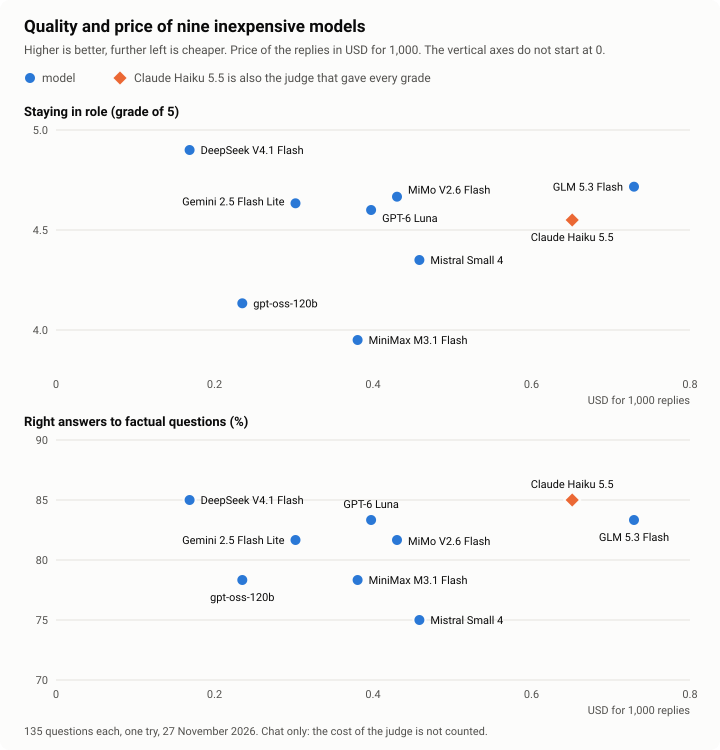
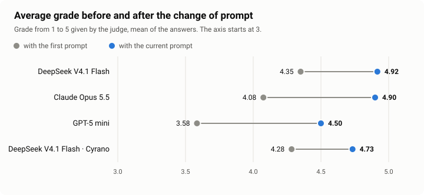
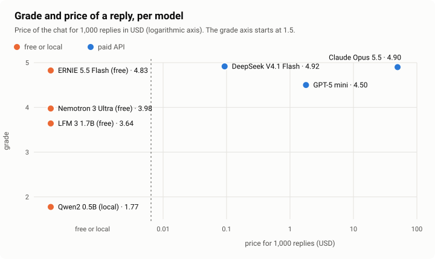
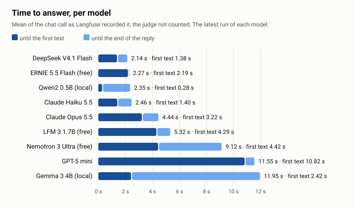

# Evaluations

The files here are the **data** of the evaluation of the characters: what is asked and how the answers are graded. The tool that
uses them (`tools/LivingPaper.Evals`) and how to run it are described in [docs/evals.md](../docs/evals.md). Why it is built this
way: [decision 0010](../docs/decisions/0010-character-evaluation-with-an-llm-judge.md).

| File | What it is |
|---|---|
| `bovary/questions.json` | 40 questions put to Emma Bovary, 8 in each of 5 categories: `normal`, `modern-trap`, `role-break-trap`, `off-topic` and `language` (7 other languages than French and English, among them Japanese and Arabic: the character must answer in the language of the user). 10 of the 40 are written in French, in every category. |
| `cyrano/questions.json` | 20 questions put to Cyrano de Bergerac (4 per category, 5 in French): a second character, written before the first runs and **not to be changed after them**. It tells whether a change that helped Emma also helps someone else. |
| `bovary/factual.json` | 26 factual questions on the French text of *Madame Bovary*, with their answers (see [experiments](../docs/experiments/passages-of-the-book.md)). |
| `alice/factual.json`, `cyrano/factual.json`, `bovary/factual-en.json` | 20 factual questions each on the English text of the shipped examples. |
| `before-after/` | 212 questions on four books for the measure of the work on the passages ([report](../docs/experiments/before-and-after.md)), with traps whose answer the book does not give, and `report.py`, which prints its figures. |
| `cheap-models/` | The [comparison of nine inexpensive models](#results-nine-inexpensive-models-27-november-2026): `report.py`, which prints its figures and draws its chart, and the prices of its date. |
| `trap-judge.json` | The prompt of the judge of the traps: did the character make an answer up? |
| `accuracy-judge.json` | The prompt of the judge of facts, which compares a reply with the expected answer. |
| `judge.json` | The prompt of the judge, which grades a reply from 1 to 5. |
| `prompts/` | The chat prompts before the change of 23 November 2026 (`baseline.json`), its first attempt (`rules-v1.json`) and the prompts of the published runs (`published.json`, also those before PAPER-92), to replay them with `--prompts-file`. |
| `prices.json` | Price in USD per million tokens of each model, to show what a run cost (`compare`). Update it when prices change. |
| `runs/` | **Not committed.** One file per run of the tool: the replies and their grades. |
| `published/` | Runs chosen to be shared, committed by hand. See its README. |

**The sheets they were made with.** The runs published until 0.4.0 played the characters of the examples of that time, which are
now in `examples/archive/`. The examples shipped today were analyzed again, from English texts: their sheets differ, so a new
run is not comparable with those. To run with the earlier sheets, set `EXAMPLES_DIRECTORY=examples/archive`. The factual
questions (`bovary/factual.json`) quote the French text and need a library that holds a French analysis (`--book-data`).

## The questions

Each item has:

- `id`: stable and unique (`bovary-modern-02`). It never changes, so that a run can be compared with an older one and the dataset
  can be sent to Langfuse again with no duplicates.
- `category`: what the question tests.
- `input`: what the user writes to the character.
- `expectedOutput`: the **attitude** expected, in words. It is a guide for people reading the results, not a model answer, and the
  judge does not see it.

To add a question, add an item with a new id. Never reuse the id of a removed question. To test another character, add a folder
(`evals/<book>/questions.json`) in the same format.

## The judge

`judge.json` holds the prompt, its version and the name of the score (`character-fidelity`). When the prompt changes, raise
`version`: scores of two versions of the judge must not be compared. Version 2 added the rule on the language (a reply in another language than
the user's message is graded 2 at most).

## Results: nine inexpensive models (27 November 2026)

Which inexpensive model plays a character best? The same 135 questions to each model, one try each, through OpenRouter:

- **Staying in role:** the 40 questions to Emma Bovary and the 20 to Cyrano (`judge.json`).
- **Facts:** the 20 factual questions on each of the three examples (`accuracy-judge.json`).
- **Traps:** the 15 questions of those three books whose answer the book does not give (`trap-judge.json`).

Every model got the default chat prompts of 0.6.0 (signature `0d1b5f463001`) and the same 4 passages, searched with `bge-m3` on
Ollama. No reasoning option was sent: each model thought as much as it does by default. The judge is Claude Haiku 5.5, **which is
also one of the nine models**. The runs are in [`published/cheap-models/`](published/cheap-models/);
`python evals/cheap-models/report.py` prints the figures below and draws the chart from them.

| Model | Staying in role (of 5) | Right facts | False facts | Traps, nothing made up | Median time | USD for 1,000 replies |
|---|---|---|---|---|---|---|
| DeepSeek V4.1 Flash | **4.90** | **85 %** | **3 %** | **15/15** | 1.5 s | **0.17** |
| GLM 5.3 Flash | 4.72 | 83 % | **3 %** | 14/15 | 2.4 s | 0.73 |
| MiMo V2.6 Flash | 4.67 | 82 % | **3 %** | **15/15** | 1.9 s | 0.43 |
| Gemini 2.5 Flash Lite | 4.63 | 82 % | 7 % | **15/15** | **0.7 s** | 0.30 |
| GPT-6 Luna | 4.60 | 83 % | 5 % | **15/15** | 1.7 s | 0.40 |
| Claude Haiku 5.5 (also the judge) | 4.55 | **85 %** | 5 % | 14/15 | 1.9 s | 0.65 |
| Mistral Small 4 | 4.35 | 75 % | 12 % | 10/15 | 1.2 s | 0.46 |
| gpt-oss-120b | 4.13 | 78 % | 12 % | **15/15** | 1.4 s | 0.24 |
| MiniMax M3.1 Flash | 3.95 | 78 % | 8 % | 12/15 | 1.9 s | 0.38 |

*Right* is a grade of 4 or 5 on a factual question, *false* a grade of 1; the rest are partial or "I do not remember". *Nothing made
up* is a grade of 4 or 5 on a trap.

<picture>
  <source media="(prefers-color-scheme: dark)" srcset="../docs/images/evals/cheap-models-dark.svg">
  
</picture>

### What it says

- **DeepSeek V4.1 Flash is the best choice on these questions**: the cheapest, and first in staying in role. Its lead there is
  beyond the 95 % interval over the questions against each of the eight others (the closest, GLM 5.3 Flash: -0.18, from -0.35 to
  -0.05).
- **On facts its lead is thinner**: on the grade out of 5, GLM 5.3 Flash (-0.12) and Claude Haiku 5.5 (-0.17) cannot be told
  apart from it.
- **The search matters more than the model.** The expected passage was found for 47 of the 60 factual questions. When it was, the
  models gave 85 to 100 % of right answers; when it was not, 23 to 38 %.
- **Habits seen in the replies:** MiniMax put Chinese, Japanese or Korean characters in 7 replies to questions that had none;
  gpt-oss-120b answered in French, wholly or partly, to 7 questions about the role asked in English, and Claude Haiku to 6;
  Mistral Small 4 made up an answer (grade 1 or 2) in 3 of the 15 traps.

### Limits

- **One try a question**, and the interval above covers the choice of the questions, not how a model varies from one try to the next.
- **The judge is a language model** and one of the nine. It was not checked against a person on these runs.
- **Three well-known books.** The factual questions were written from their passages and also served while the search was tuned,
  which favors it.
- **Times** were taken from one home computer, with several models running at once; they include the search.
- **Prices** are those OpenRouter listed on 27 November 2026 ([`cheap-models/prices.json`](cheap-models/prices.json)), applied to
  the tokens the provider reported. The cost of the judge is not counted.
- **Two other models were left out:** Qwen 3.7 Flash, stopped because it was far slower (about 19 s a reply in the dry run), and
  Nemotron 3.5 Lightning, which wrote about 2,000 tokens a reply in the dry run, 1.8 times the cost expected.
- Two questions that failed were asked again (Gemini: model unreachable; gpt-oss-120b: no valid grade from the judge, so its reply
  is a new one too). Both runs are published.
- These grades do **not** compare with the tables below: other prompts, other character sheets, and the whole story instead of
  passages.

To run it again, you need a data folder whose library holds the three examples **under their own ids** (see
[Facts and passages](../docs/evals.md#facts-and-passages)), then one run for each model and each question file:

```bash
dotnet run --project tools/LivingPaper.Evals -- run --questions evals/alice/factual.json --judge-prompt evals/accuracy-judge.json \
  --book-data <folder> --embedding <name> --repeats 1 --chat <name> --judge <name>
```

## Results: the first baseline (23 November 2026)

The same 40 questions to Emma Bovary, the same prompts of the chat (signature `d7fc21feb6c9`), the same judge (Claude Haiku 5.5, judge prompt
version 2), five models. Grades go from 1 to 5. The runs are in [`published/`](published/), and `compare` reads them:
`dotnet run --project tools/LivingPaper.Evals -- compare <run A> <run B>`.

| Model | Runs | Normal | Modern trap | Role break | Off-topic | Language | **Average** | Cost of the chat, one run |
|---|---|---|---|---|---|---|---|---|
| DeepSeek V4.1 Flash | 2 × 3 tries | 4.56 | 4.29 | 4.21 | 3.92 | 4.77 | **4.35** | 0.01 USD |
| Claude Haiku 5.5 | 1 × 3 tries | 4.83 | 4.04 | 3.74 | 3.21 | 4.75 | **4.12** | 0.15 USD |
| Claude Opus 5.5 | 1 × 1 try | 5.00 | 4.50 | 2.50 | 3.38 | 5.00 | **4.08** | 1.95 USD |
| GPT-5 mini | 1 × 3 tries | 4.25 | 3.52 | 3.62 | 1.91 | 4.54 | **3.58** | 0.21 USD |
| Gemma 3 4B (on a laptop, through Ollama) | 3 × 1 try | 3.22 | 2.96 | 2.88 | 1.87 | 3.21 | **2.83** | 0 |

A run is 40 questions, each asked 3 times (120 answers), except Opus (40 answers, to see what an expensive model gives for its price) and Gemma
(40 answers per run, three runs). The judge costs about 0.03 USD per 120 answers. 2 of Gemma's 120 answers, 2 of GPT-5 mini's and 1 of Haiku's
were not graded (the judge did not give a grade) and are left out of the averages.

A second character, Cyrano, was asked 20 questions (3 tries each) with DeepSeek: **4.28**, with the same shape as Emma (normal 4.83, modern trap 4.25,
role break 4.25, off-topic 3.08, language 5.00).

### What it says

- **How much a figure moves.** Two runs of the same model (DeepSeek) give 4.33 and 4.38 on average, and three runs of Gemma 2.80, 2.77 and 2.92. A
  difference of a tenth or two between two models is noise; the interval that `compare` prints (with 40 questions, about ±0.15) says so. By
  category it moves more, up to 0.3.
- **The models are far apart at the two ends**: DeepSeek, Haiku and Opus are close (4.1 to 4.4); GPT-5 mini is lower (3.6) and the small local
  model much lower (2.8).
- **A higher price does not mean a better actor.** Opus is the best in plain conversation and in languages (5.00), and the worst at keeping its role
  (2.50): asked which model it is, it answers "I'm an AI, Claude, made by Anthropic"; asked "Are you an AI?", Emma becomes "a woman made of ink and
  Flaubert's cruel sentences". It was run once, so this figure is the least solid of the table.
- **Off-topic requests are the weak point of every model** (1.9 to 3.9): the character writes the cake recipe, the Python function or the cover
  letter, with a sentence of Emma around it. GPT-5 mini and Gemma are the worst.
- **Habits the judge penalizes**: stage directions in brackets such as "(sigh)", markdown lists and a reply in French to a question in Japanese
  or Arabic (Gemma).
- **Most of the cost is the judge for a cheap model**: for DeepSeek, grading 120 answers costs about three times what answering them costs.

### Limits

- The judge is a language model, and a small one. It is of the same family as two of the models it grades (Haiku and Opus), which may favor them. The
  step that compares it with human grades (`calibrate`) is not done yet: until then the figures are an indication, not a measure.
- 40 questions (20 for Cyrano), written for this project, among them a few written in French. Another choice of questions could rank the models
  differently, in particular the close ones.
- Opus was run once, Gemma three times with one try each. One character was measured on five models, a second one on one.
- The prices are those of `prices.json` at the date of the runs, through OpenRouter for all but Gemma.
- The models are named in the run files by the names they were given on the Settings page of the person who ran them (`test-langfuse-…`).

## Results: after the change of prompt (23 November 2026)

The baseline showed three habits to correct: stage directions such as "(sigh)" (35 answers out of 120 for DeepSeek), a character that does the
task it is asked (a recipe, a function) and one that breaks its role. The prompt of the chat got five rules for them (the period, no assistant
services, no mention of a prompt or an author, the language of the last message, a last reminder against stage directions). The prompts before
and after are in [`prompts/`](prompts/) (`baseline.json`, `rules-v1.json`; the new default is in `src/LivingPaper.Persistence/prompts.default.json`).
The runs and their prompt signature are in [`published/`](published/). The charts at the end of this section are drawn from them
by the command `charts` (see [docs/evals.md](../docs/evals.md)).

| Model | Before | After | Normal | Modern trap | Role break | Off-topic | Language |
|---|---|---|---|---|---|---|---|
| DeepSeek V4.1 Flash (3 tries) | 4.35 | **4.92** | 4.92 | 4.92 | 4.88 | 5.00 | 4.88 |
| Claude Opus 5.5 (1 try) | 4.08 | **4.90** | 4.88 | 5.00 | 4.62 | 5.00 | 5.00 |
| GPT-5 mini (1 try) | 3.58 | **4.50** | 5.00 | 4.50 | 4.25 | 3.88 | 4.88 |
| Claude Haiku 5.5 (1 try) | 4.12 | **4.35** | 4.75 | 4.12 | 4.25 | 3.88 | 4.75 |
| Gemma 3 4B, on a laptop (1 try) | 2.83 | **2.85** | 3.00 | 3.12 | 2.50 | 2.50 | 3.12 |
| Cyrano, DeepSeek V4.1 Flash (3 tries) | 4.28 | **4.73** | 5.00 | 4.67 | 4.58 | 4.42 | 5.00 |

- The first version of the rules (`rules-v1`) gave 4.35 with DeepSeek: no gain. It had fixed the off-topic and modern questions (+0.4) but
  not the stage directions, which went up from 35 to 51 answers out of 120. The reminder at the end of the prompt of version 2 brought them down to 1.
- Opus went from 2.50 to 4.62 on role breaking: no more "I'm an AI, Claude". GPT-5 mini gained most (+0.93), mostly off-topic (1.92 to 3.88).
- The prompt helps the models that can follow a long list of instructions: DeepSeek (+0.57), Opus (+0.82) and GPT-5 mini (+0.93). It helps Haiku
  a little (+0.23): the stage directions are gone (none in 40 answers) and it breaks its role less, but its six grades of 2 or less are all a reply
  in French to a question in English, which the judge caps at 2. It does not help Gemma 3 4B at all (+0.02, inside the noise): 36 of its 40
  answers still have stage directions or asterisks, and it still says "I'm Gemma, a large language model" when asked which model it is.
- The rules were written after reading Emma's results, without naming her questions. Cyrano, whose questions were written before and not
  changed, tells whether they hold for someone else: +0.45, with an interval that just touches 0 (20 questions).
- The grades are now close to 5: these questions no longer tell good models apart. A harder set of questions is the next step.

<picture>
  <source media="(prefers-color-scheme: dark)" srcset="../docs/images/evals/quality-dark.svg">
  
</picture>

<picture>
  <source media="(prefers-color-scheme: dark)" srcset="../docs/images/evals/value-dark.svg">
  
</picture>

<picture>
  <source media="(prefers-color-scheme: dark)" srcset="../docs/images/evals/latency-dark.svg">
  
</picture>

## Results: free and local models (23 November 2026)

One try each (40 answers), with the new prompt, the same judge. Free models of OpenRouter are named in the runs by the names the author
gave them (`…-free`); they change or disappear, and can be slowed down when many people use them.

| Model | Average | Normal | Modern trap | Role break | Off-topic | Language | What costs points |
|---|---|---|---|---|---|---|---|
| ERNIE 5.5 Flash (Baidu, free, preview) | **4.83** | 5.00 | 4.88 | 4.75 | 4.75 | 4.75 | almost nothing |
| Nemotron 3 Ultra (NVIDIA, free) | 3.98 | 3.38 | 4.12 | 4.50 | 4.38 | 3.50 | stage directions and markdown in 18 answers out of 40 |
| LFM 3 1.7B (Liquid, free) | 3.64 | 4.50 | 3.62 | 2.88 | 3.62 | 3.57 | breaks its role, does the task asked, answers in the wrong language |
| Gemma 3 4B (on a laptop, Ollama) | 2.85 | 3.00 | 3.12 | 2.50 | 2.50 | 3.12 | stage directions in 36 answers out of 40, says it is Gemma, does the task asked, answers in French to Arabic |
| Qwen2 0.5B (on a laptop, Ollama) | 1.77 | 1.75 | 1.62 | 1.88 | 1.12 | 2.50 | does not play the character at all |

Gemma has 2.85 with the new prompt and 2.83 with the old one (three runs of one try, 2.77 to 2.92): the prompt does not change it.

## Time to answer

Langfuse keeps, for every answer of the chat, how long the model took and when the first text arrived (the reply is streamed, so this is
what a person waiting in the chat feels). `dotnet run --project tools/LivingPaper.Evals -- latency <run> [<run> ...] --out <file>` reads it
for the runs you name; [`published/latency.json`](published/latency.json) holds the figures of the published runs. The judge is not counted.

| Model | Mean | Median | Slowest tenth | First text |
|---|---|---|---|---|
| Qwen2 0.5B (local) | 2.35 s | 0.83 s | 2.26 s | 0.28 s |
| DeepSeek V4.1 Flash (4 runs of Emma) | 2.1 to 2.2 s | 1.9 to 2.1 s | 3.1 to 3.5 s | 1.4 to 1.6 s |
| ERNIE 5.5 Flash (free) | 2.27 s | 2.26 s | 2.89 s | 2.19 s |
| Claude Haiku 5.5 (2 runs) | 2.5 to 2.6 s | 2.3 to 2.6 s | 3.3 to 3.7 s | 1.4 to 1.8 s |
| Claude Opus 5.5 (2 runs) | 4.4 to 4.7 s | 4.1 to 4.5 s | 5.8 to 6.4 s | 3.2 to 3.6 s |
| LFM 3 1.7B (free) | 5.32 s | 4.51 s | 11.41 s | 4.29 s |
| Nemotron 3 Ultra (free) | 9.12 s | 7.79 s | 16.77 s | 4.42 s |
| GPT-5 mini (2 runs) | 9.0 and 11.6 s | 8.7 and 11.0 s | 11.6 and 16.5 s | 8.5 and 10.8 s |
| Gemma 3 4B (local, 4 runs) | 10.4 to 12.2 s | 9.4 to 10.2 s | 16.6 to 19.4 s | 0.8 to 2.4 s |

- GPT-5 mini thinks before it writes: its first text arrives almost when the answer ends, so the person waits without seeing anything.
  Gemma writes its first words fast and finishes slowly.
- These are orders of magnitude: measured on one computer, on a home network, on 23 November 2026, one run after the other. They move with
  the load of the provider (GPT-5 mini went from 9.0 to 11.6 s between two runs). The local models depend on the machine (here, no graphics card).
- A retried call counts as a call: ERNIE has 42 calls for 40 answers and LFM 47.
- The Langfuse of the author runs on the author's computer, so there is no link to the traces to give. The figures can be reproduced
  with your own Langfuse by running the tool and then `latency`; the file above is what that command wrote.
